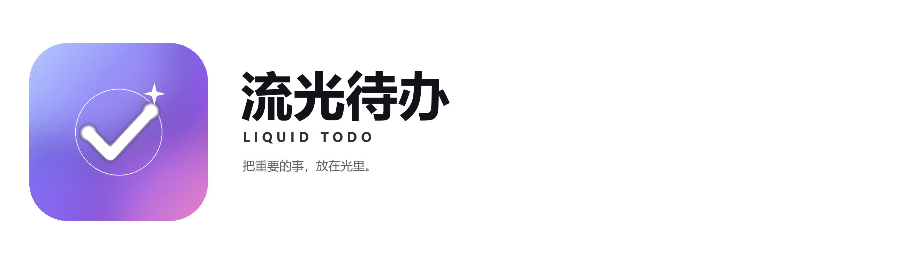

# AI 辅助开发声明 / AI-Assisted Development Declaration

  

流光待办 / Liquid Todo · v3.2.6 (versionCode 14) · Rivers Yuri · 2026-11-01

> **人类开发者是产品的决策者、守护者与最终责任人。**  
> **The human developer is the decision-maker, guardian, and ultimately accountable owner.**

### 人类价值 / Human value

**中文：** AI 可以加速起草、重构与翻译，但不能替代人的产品判断、真实体验和最终责任。人类开发者主导了“离线优先、无账号、数据留在本机”的方向，确定隐私与加密边界，并**在真实设备上实际安装、冷启动、切换深浅色、体验三档触感、观察开屏动画、验证备份恢复、外部跳转与边界场景**。这些实际测试与发布判断由人类完成。

**English:** AI can speed up drafting, refactoring, and translation, but it cannot replace human product judgment, real-world experience, or final accountability. The human developer led the offline-first, account-free, local-data direction; defined the privacy and encryption boundaries; and **installs the APK on real devices, cold-starts it, switches themes, feels all three haptic levels, watches the splash animation, and verifies backup/restore, external links, and edge cases**. Actual testing and release judgment remain human.

### AI 参与 / AI contribution

**中文：** AI 编程助手（DeepSeek Harness / DeepSeek 模型）参与了代码梳理、局部重构、界面与文案建议、测试脚本、构建脚本和文档起草。AI 是工具，不是作者、开发者、权利人或发布者；所有辅助结果均经人类筛选、修改和验收。

**English:** An AI coding assistant (DeepSeek Harness / DeepSeek model) contributed to codebase analysis, localized refactoring, interface and copy suggestions, test scripts, build scripts, and documentation drafts. AI is a tool, not the author, developer, rights holder, or publisher; every assisted result was screened, edited, and accepted by the human developer.

### 责任与边界 / Responsibility and boundaries

- **实际测试 / Real testing：** 人类开发者负责真机安装、冷启动、深浅色、三档触感、开屏、备份恢复、外部跳转和边界场景的最终验证；AI 不能替代这些体验判断。  
  The human developer is responsible for final real-device validation of installation, cold start, themes, all three haptic levels, splash, backup/restore, external links, and edge cases; AI cannot replace that experience judgment.
- **运行时与隐私 / Runtime and privacy：** 应用不包含 AI 模型、不调用云端 AI、不申请 INTERNET 权限、不提供账号，也不上传待办、标签或备份；数据保存在本机，加密备份由用户保管。开发中未向 AI 工具提供真实生产用户数据。  
  The app contains no AI model, makes no cloud AI calls, requests no INTERNET permission, has no account system, and uploads no tasks, tags, or backups; data stays local and encrypted backups are controlled by the user. No real production user data was provided to AI tools during development.
- **知识产权 / Intellectual property：** 项目的原创设计、品牌、界面与业务代码由开发者负责；第三方开源组件继续遵循其各自许可证，声明可在应用内“隐私与协议 → 开源许可证”查看。  
  The developer remains responsible for the original design, brand, interface, and business code; third-party open-source components remain under their respective licenses, available in the app under “Privacy & agreements → Open source licenses.”
### 免责声明 / Disclaimer (AS IS)

**中文：**  
本软件、源代码、文档及相关材料（以下合称“本软件”）按**“现状”（AS IS）**和**“现有”（AS AVAILABLE）**提供。在适用法律允许的最大范围内，开发者、贡献者、版权持有人及发布者明确拒绝作出任何明示或默示的保证，包括但不限于适销性、特定用途适用性、所有权、不侵权、准确性、完整性、安全性、无错误、无中断、无有害组件及兼容性的保证。本软件不保证满足用户需求，也不保证数据不会丢失或损坏。

**责任限制：** 在适用法律允许的最大范围内，无论基于合同、侵权（包括过失）、严格责任或其他法律理论，即使已被告知可能发生损害，开发者、贡献者、版权持有人及发布者均不对因本软件、本软件的使用、无法使用或依赖本软件而产生的任何直接、间接、附带、特殊、惩罚性或后果性损害承担责任，包括但不限于数据丢失、利润损失、业务中断、设备损坏或第三方索赔。用户应自行备份数据，并自行判断设备兼容性、安装与使用风险。

**法律例外：** 部分司法辖区不允许排除默示保证或限制附带/后果性损害，因此上述部分排除或限制可能不适用于用户。若某一条款被认定无效或不可执行，应在最小必要范围内调整，其余条款继续有效。本条不排除或限制依据适用法律不得排除或限制的责任（包括故意不当行为、重大过失、欺诈或人身伤害等依法不得限制的责任）。本声明不构成法律意见。

**English:**  
The software, source code, documentation, and related materials (collectively, “the Software”) are provided **“AS IS”** and **“AS AVAILABLE,”** without warranty of any kind. To the maximum extent permitted by applicable law, the developer, contributors, copyright holders, and publishers disclaim all express or implied warranties, including, without limitation, warranties of merchantability, fitness for a particular purpose, title, non-infringement, accuracy, completeness, security, error-free or uninterrupted operation, freedom from harmful components, and compatibility. No warranty is given that the Software will meet the user's requirements or that data will not be lost or corrupted.

**Limitation of liability:** To the maximum extent permitted by applicable law, and regardless of the legal theory—whether contract, tort (including negligence), strict liability, or otherwise—and even if advised of the possibility of such damage, the developer, contributors, copyright holders, and publishers shall not be liable for any direct, indirect, incidental, special, punitive, or consequential damages arising from or relating to the Software, its use, inability to use, or reliance on it, including, without limitation, loss of data, loss of profits, business interruption, device damage, or third-party claims. Users are responsible for backing up their data and for assessing device compatibility, installation, and usage risks.

**Statutory exceptions:** Some jurisdictions do not allow the exclusion of implied warranties or the limitation of incidental or consequential damages, so some of the above exclusions or limitations may not apply. If any provision is held invalid or unenforceable, it shall be modified to the minimum extent necessary and the remaining provisions shall remain in effect. Nothing in this disclaimer excludes or limits liability that cannot be excluded or limited under applicable law, including liability for willful misconduct, gross negligence, fraud, or personal injury where such liability cannot lawfully be limited. This disclaimer is not legal advice.

**Reference standard (MIT-style):**  
THE SOFTWARE IS PROVIDED “AS IS,” WITHOUT WARRANTY OF ANY KIND, EXPRESS OR IMPLIED, INCLUDING BUT NOT LIMITED TO THE WARRANTIES OF MERCHANTABILITY, FITNESS FOR A PARTICULAR PURPOSE AND NONINFRINGEMENT. IN NO EVENT SHALL THE AUTHORS OR COPYRIGHT HOLDERS BE LIABLE FOR ANY CLAIM, DAMAGES OR OTHER LIABILITY, WHETHER IN AN ACTION OF CONTRACT, TORT OR OTHERWISE, ARISING FROM, OUT OF OR IN CONNECTION WITH THE SOFTWARE OR THE USE OR OTHER DEALINGS IN THE SOFTWARE.

### 结语 / Closing

**AI 提高效率；人负责判断、体验与责任。**  
**AI improves efficiency; people own judgment, experience, and accountability.**

**联系 / Contact：** flicks.meek.3y@icloud.com
