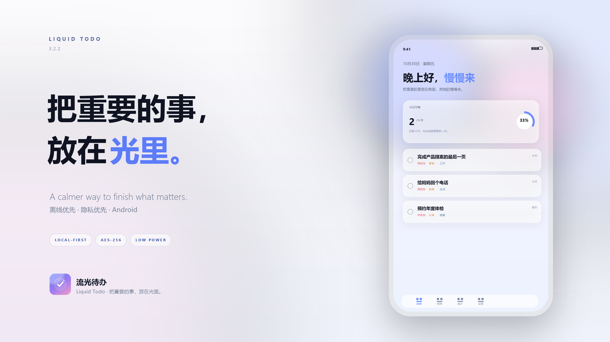
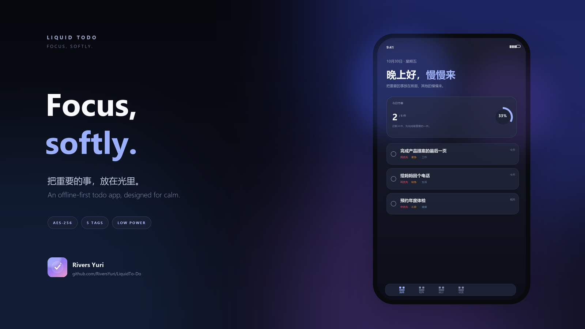
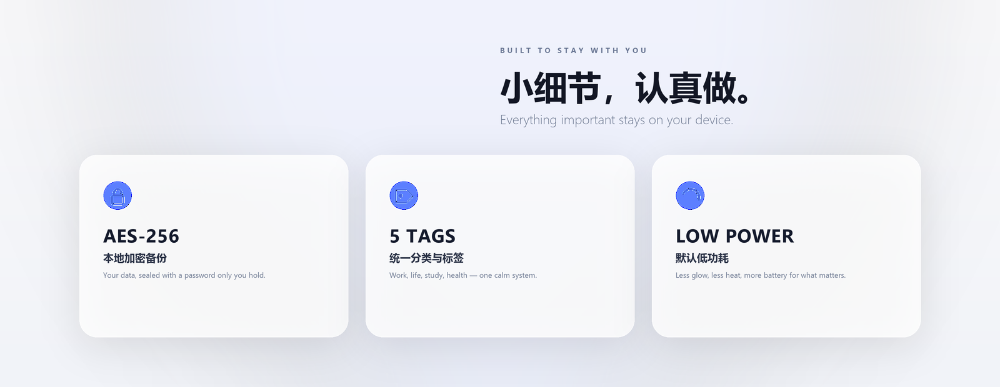

# LiquidTo-Do
Put the important things in the light. An offline-first, privacy-respecting to-do app.把重要的事，放在光里。
# 流光待办 · Liquid Todo

一款离线优先的 Android 待办应用，用「重要程度 × 紧急程度」组织任务。界面采用半透明玻璃、渐变光和柔和动效。
## 📦 下载
👉 [前往 Releases 下载最新 APK](https://github.com/RiversYuri/LiquidTo-Do/releases/latest)
<p align="center">
  
</p>

<p align="center">
  <sub>把重要的事，放在光里。</sub>
</p>

<p align="center">
  <a href="https://github.com/RiversYuri/LiquidTo-Do">GitHub</a>
  &nbsp;·&nbsp;
  <a href="CHANGELOG.md">Changelog</a>
  &nbsp;·&nbsp;
  Android 8.0+ &nbsp;·&nbsp; Offline first
</p>

当前版本：**3.2.3**（versionCode 11）   
更新日志：[CHANGELOG.md](CHANGELOG.md)

<p align="center">
  
</p>

<p align="center">
  
</p>


## 功能

### 待办与优先级
- 新建、编辑、完成、删除、撤销删除。
- 重要程度（低/中/高）× 紧急程度（从容/较急/紧急）。
- 截止日期：今天 / 明天 / 后天 / 自定义日期 / 不设期限。
- 分类与标签已整合为统一标签体系（默认工作、生活、学习、健康）。
- 智能排序：重要程度 / 紧急程度 / 用户自定义三种模式。
- 自定义排序支持上移、下移，顺序写入 Room 的 `tasks.sortOrder`。
- 艾森豪威尔矩阵、今日行动建议。
- 今日进度、7 天趋势、连续完成、最高效一天、优先级分布。
- “已完成”筛选页一键清空并支持撤销。

### 统一标签
- 分类与标签合并为同一套标签：默认工作、生活、学习、健康。
- 最多 5 个标签，8 种柔和预设色；可新增、改名、改色、删除。
- 新建/编辑待办时可选一个标签或不选。
- 首页标签筛选栏：全部 / 标签，与原有的全部、今天、重要、完成筛选叠加。
- 删除标签只清除关联，不删除待办。
- Room `tags` 表与 `tasks` 表通过 `tag_id` 一对多关联。
- 旧版固定分类会自动迁移为默认标签，任务关联保留。

### 本地加密备份与恢复
- 设置 → 数据与备份。
- 备份通过 `ACTION_CREATE_DOCUMENT` 选择保存位置，文件扩展名 `.liquidbackup`。
- AES-256-GCM 加密；密钥由用户密码经 PBKDF2-HMAC-SHA256（210,000 次迭代、随机 salt）派生。
- 恢复通过 `ACTION_OPEN_DOCUMENT` 选择文件，解密后展示条目摘要，可选择**合并**或**覆盖**。
  - 合并只加入备份中不存在的条目，保留当前数据；
  - 覆盖替换当前全部待办与标签。
- v3.2.2 修复：备份直接携带当前 JS 状态，恢复在网页侧解析并立即写入清单，不再依赖“等待原生重建”才显示数据。
- v3.2.3 修复：合并时备份条目复用已有 ID 但标题不同，会生成新 ID 插入，不再被静默丢弃。
- 不需要存储权限，不使用网络，不上传任何数据。

### 外观与体验
- 浅色 / 深色主题；右上角快捷按钮 + 设置页开关。
- 跟随系统：Xiaomi HyperOS 3.0 / Android 14+ 通过原生 `Configuration.uiMode` 同步。
- 兼容模式：保留玻璃和界面动效，仅降低模糊和无限环境动画，并记住选择。
- 低功耗运行：**默认开启**；减少环境动画、背景模糊与后台占用。关闭时会弹出二级确认，提示功耗、发热和稳定性风险。
- 原生开屏覆盖层 + WebView 交叉淡入，消除白屏闪烁。
- 分时段问候：深夜提示“早些休息”，不再使用“慢慢来”。
- 矩阵单个象限任务较多时可展开/收起。
- 英文界面：设置页可切换简体中文 / English。
- 首次启动同时提供 **语言选择** 与隐私政策 / 用户协议同意页；设置页可随时查看。
- 关于页提供 GitHub 仓库入口：<https://github.com/RiversYuri/LiquidTo-Do>。
- 关于页可查看完整更新日志。

### 设置与关于
- 跟随系统 / 深色模式。
- 显示语言：简体中文 / English。
- 兼容模式 / 低功耗运行。
- 标签管理。
- 数据与备份。
- 隐私政策 / 用户协议。
- 开发者：**Rivers Yuri**
- 联系邮箱：**flicks.meek.3y@icloud.com**
- 版本、隐私说明、更新日志。
- GitHub 仓库：`RiversYuri/LiquidTo-Do`。

## 数据与隐私

- **不申请 `INTERNET` 权限**，应用无法联网。
- **没有登录、账号、云同步、广告、统计 SDK**。
- 唯一权限：`VIBRATE`（触感反馈）。
- 任务/标签：Room 数据库 `liquid_todo.db`。
- 主题：SharedPreferences `todo_theme`。
- 兼容模式/低功耗：SharedPreferences `safe_mode` / `low_power_mode`。
- 排序/语言：SharedPreferences `list_sort` / `app_lang`。
- 隐私同意：SharedPreferences `privacy_accepted`。
- 标签迁移标记：SharedPreferences `tag_schema_v1`。
- 旧版 `todo_state_v1` JSON 会在首次启动时迁移进 Room，原始值保留用于回退。
- 联系开发者通过系统 `mailto:` 邮件应用，不经过应用内网络请求。

## 数据模型

```text
tags
  id TEXT PK
  name TEXT
  color TEXT
  sortOrder INTEGER
  createdAt INTEGER

tasks
  id TEXT PK
  title TEXT
  notes TEXT
  priority INTEGER
  urgency INTEGER
  due TEXT
  category TEXT        # 旧版字段，仅用于迁移兼容
  sortOrder INTEGER    # 自定义排序顺序（Room v2）
  tagId TEXT NULL      # FK -> tags.id, ON DELETE SET NULL
  completed BOOLEAN
  completedAt TEXT
  createdAt TEXT
```

`tasks.tagId` 是可选外键。标签删除后，关联待办保留，`tagId` 被置空。

## 技术结构

```text
app/src/main/
├── java/com/liquidtodo/app/
│   ├── MainActivity.java          # WebView 宿主、启动过渡、SAF、备份、恢复页
│   ├── BackupCrypto.java          # AES-256-GCM + PBKDF2
│   ├── LiquidTodoApp.java         # 未捕获异常记录
│   └── data/
│       ├── AppDatabase.java
│       ├── TaskEntity.java
│       ├── TagEntity.java
│       ├── TaskDao.java
│       ├── TagDao.java
│       └── TodoRepository.java    # Room <-> WebView JSON 协议、旧数据迁移
├── assets/www/
│   ├── index.html
│   ├── styles.css
│   └── app.js
├── res/                           # 主题、启动背景、图标
└── AndroidManifest.xml
```

- 原生：Java，`minSdk 26`，`targetSdk 35`，AndroidX + Room 2.6.1。
- UI：离线 HTML/CSS/JS，通过 `file:///android_asset` 加载。
- 数据：Room 负责结构化持久化，SharedPreferences 负责轻量设置。
- 备份：对 Room 逻辑数据导出 JSON 后加密，避免直接复制 WAL 数据库造成不一致。

## 构建

需要 JDK 17+、Android SDK（platform 35、build-tools 35.0.0）：

```text
gradlew.bat :app:assembleRelease
```

首次构建会从 Google Maven / Maven Central 下载 AndroidX Room 依赖。  
`local.properties` 中的 `sdk.dir` 指向本机 Android SDK。

## 验证状态

- Release 构建成功。
- Android Lint：**0 error**。
- APK Signature Scheme v2 校验通过。
- `BackupCrypto` 加密/解密/wrong-password 单元级测试通过。
- HyperOS 跟随系统、Android 14+ 适配沿用 2.1.1 修复。

## 版本记录

见 [CHANGELOG.md](CHANGELOG.md)。最近版本：3.2.3、3.2.2、3.2.1、3.1.0、3.0.0、2.1.1、2.1.0、2.0.1、2.0.0、1.0.1、1.0.0。
