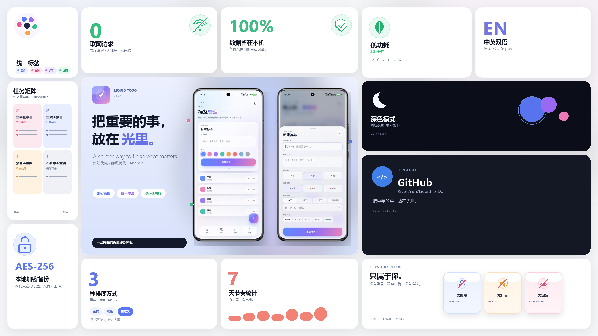
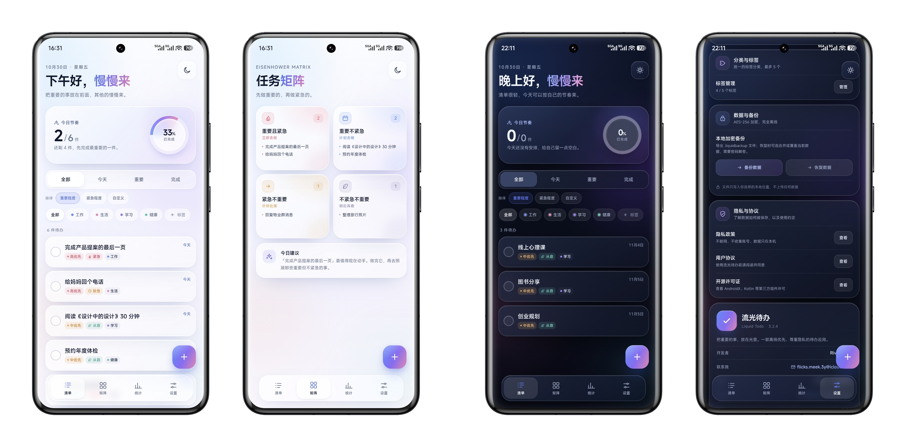
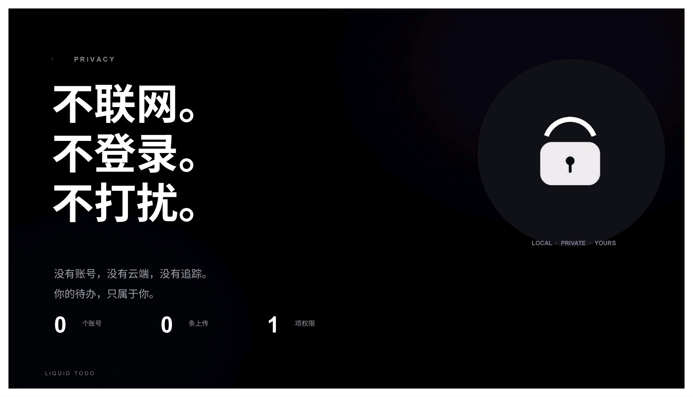

# 流光待办 · Liquid Todo
### 把重要的事，放在光里。
[](AI-DECLARATION.md)
[](LICENSE)
[](PRIVACY.md)
[](SECURITY.md)


一款离线优先、尊重隐私的 Android 待办应用，用「重要程度 × 紧急程度」组织任务。界面采用半透明玻璃、渐变光和柔和动效。
## 📦 现在就免费拥有 Liquid Todo3.0
👉 [前往 Releases 下载最新 APK](https://github.com/RiversYuri/LiquidTo-Do/releases/latest)

当前版本：**3.2.4**（versionCode 11）   
更新日志：[CHANGELOG.md](CHANGELOG.md)
<p align="center">
  
 让每一次待办，都轻盈发光。
</p>

<p align="center">
  
 先做重要的，再做紧急的。
</p>

<p align="center">
  
</p>
<p align="center"> 
  连网都不需要，何况窥探。
</p>

## ✨ 认识一下全新的 Liquid Todo3.0

### 待办与优先级
- 新建、编辑、完成、删除、撤销删除。
- 重要程度（低/中/高）× 紧急程度（从容/较急/紧急）。
- 截止日期：今天 / 明天 / 后天 / 自定义日期 / 不设期限。
- 分类与标签已整合为统一标签体系（默认工作、生活、学习、健康）。
- 智能排序：重要程度 / 紧急程度 / 用户自定义三种模式。
- 自定义排序支持上移、下移，顺序写入 Room 的 `tasks.sortOrder`。
- 艾森豪威尔矩阵、今日行动建议。
- 今日进度、7 天趋势、连续完成、最高效一天、优先级分布。
- “已完成”筛选页一键清空并支持撤销。

### 统一标签
- 分类与标签合并为同一套标签：默认工作、生活、学习、健康。
- 最多 5 个标签，8 种柔和预设色；可新增、改名、改色、删除。
- 新建/编辑待办时可选一个标签或不选。
- 首页标签筛选栏：全部 / 标签，与原有的全部、今天、重要、完成筛选叠加。
- 删除标签只清除关联，不删除待办。
- Room `tags` 表与 `tasks` 表通过 `tag_id` 一对多关联。
- 旧版固定分类会自动迁移为默认标签，任务关联保留。

### 本地加密备份与恢复
- 设置 → 数据与备份。
- 备份通过 `ACTION_CREATE_DOCUMENT` 选择保存位置，文件扩展名 `.liquidbackup`。
- AES-256-GCM 加密；密钥由用户密码经 PBKDF2-HMAC-SHA256（210,000 次迭代、随机 salt）派生。
- 恢复通过 `ACTION_OPEN_DOCUMENT` 选择文件，解密后展示条目摘要，可选择**合并**或**覆盖**。
  - 合并只加入备份中不存在的条目，保留当前数据；
  - 覆盖替换当前全部待办与标签。

### 外观与体验
- 浅色 / 深色主题；右上角快捷按钮 + 设置页开关。
- 矩阵单个象限任务较多时可展开/收起。
- 英文界面：设置页可切换简体中文 / English。
- 首次启动同时提供 **语言选择**
- 关于页提供 GitHub 仓库入口：<https://github.com/RiversYuri/LiquidTo-Do>。
- 关于页可查看完整更新日志。

## 🛡️ 隐私，是一项基本人权。

- 我们的Liquid Todo产品不收集任何数据。  
没有网络权限，没有登录，没有账号，没有云同步，没有广告，更没有统计 SDK。  
一切，只属于你的设备。
数据仅保存在本地的 **SharedPreferences** 与 **Room** 数据库中，从不离开你的掌控。

- 权限，能少则少。  
仅申请 **VIBRATE** 震动权限，只为给你恰到好处的触感反馈。
联系开发者通过系统 `mailto:` 邮件应用，不经过应用内网络请求。

- 备份，由你全权守护。  
备份文件采用 **AES‑256‑GCM** 加密，密码只有你知道。  
我们不申请存储权限。恢复时，只需通过系统文件选择器选择即可——简单、安全、透明。

## 🗂️ 数据模型

```text
tags
  id TEXT PK
  name TEXT
  color TEXT
  sortOrder INTEGER
  createdAt INTEGER

tasks
  id TEXT PK
  title TEXT
  notes TEXT
  priority INTEGER
  urgency INTEGER
  due TEXT
  category TEXT        # 旧版字段，仅用于迁移兼容
  sortOrder INTEGER    # 自定义排序顺序（Room v2）
  tagId TEXT NULL      # FK -> tags.id, ON DELETE SET NULL
  completed BOOLEAN
  completedAt TEXT
  createdAt TEXT
```

`tasks.tagId` 是可选外键。标签删除后，关联待办保留，`tagId` 被置空。

## ⚙️ 技术结构

```text
app/src/main/
├── java/com/liquidtodo/app/
│   ├── MainActivity.java          # WebView 宿主、启动过渡、SAF、备份、恢复页
│   ├── BackupCrypto.java          # AES-256-GCM + PBKDF2
│   ├── LiquidTodoApp.java         # 未捕获异常记录
│   └── data/
│       ├── AppDatabase.java
│       ├── TaskEntity.java
│       ├── TagEntity.java
│       ├── TaskDao.java
│       ├── TagDao.java
│       └── TodoRepository.java    # Room <-> WebView JSON 协议、旧数据迁移
├── assets/www/
│   ├── index.html
│   ├── styles.css
│   └── app.js
├── res/                           # 主题、启动背景、图标
└── AndroidManifest.xml
```

- 原生：Java，`minSdk 26`，`targetSdk 35`，AndroidX + Room 2.6.1。
- UI：离线 HTML/CSS/JS，通过 `file:///android_asset` 加载。
- 数据：Room 负责结构化持久化，SharedPreferences 负责轻量设置。
- 备份：对 Room 逻辑数据导出 JSON 后加密，避免直接复制 WAL 数据库造成不一致。


## 🌐 支持与新功能，随时为你准备
<div align="center" style="background: #f8f9fa; border-radius: 14px; padding: 22px 28px; max-width: 400px; margin: 0 auto;">

<p style="margin: 4px 0; font-size: 14px;">
📕 <a href="https://xhslink.cn/o/AqyB8AmY4X1" style="color: #666; text-decoration: none;">小红书</a> &nbsp;&nbsp;
🐦 <a href="https://weibo.com/u/7690048866" style="color: #666; text-decoration: none;">微博</a> &nbsp;&nbsp;
📺 <a href="https://b23.tv/1KJQfJj" style="color: #666; text-decoration: none;">哔哩哔哩</a>
</p>

<p style="margin: 6px 0 0 0; font-size: 14px;">
✉️ <a href="mailto:flicks.meek.3y@icloud.com" style="color: #666; text-decoration: none;">Bug反馈邮箱</a>
</p>

<p style="margin: 16px 0 0 0; font-size: 11px; color: #aaa; border-top: 1px solid #e8e8e8; padding-top: 12px;">把重要的事，放在光里。</p>

</div>

<p align="center" style="margin: 20px 0 8px 0;">
  <a href="https://github.com/RiversYuri/LiquidTo-Do" style="color: #666;">GitHub</a>
  &nbsp;·&nbsp;
  <a href="CHANGELOG.md" style="color: #666;">Changelog</a>
  &nbsp;·&nbsp;
  Android 8.0+ &nbsp;·&nbsp; Offline first
</p>

<div align="center" style="font-size: 12px; color: #999;">
© Rivers Yuri 2026 All rights reserved.
</div>

